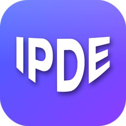

# IPDE

<p align="center"></p>

**IPDE** es el motor de videojuegos de **IkersStudio**, escrito desde cero en C++17.

- **Plataforma:** Windows (x86_64). Un único `IPDE.exe`, sin instalador ni dependencias.
- **Renderizador propio por software:** funciona en cualquier PC, sin depender de drivers de GPU.
- **Panel de proyectos:** crear, importar y abrir proyectos.
- **Motor 3D propio:** rasterizador por software multihilo con buffer de profundidad, luz de sol con sombras, luces puntuales, materiales (rugosidad, metal, emisión, texturas PNG), niebla, cielo y tonemapping. Primitivas (cubo, esfera, plano, cilindro, cono, toro, cápsula) y modelos `.obj`.
- **Editor 3D:** cámara orbital, selección con clic, mover objetos arrastrando, panel de entorno (cielo, sol, sombras, niebla).
- **Juego 3D:** jugador en tercera persona (WASD, salto, colisiones), monedas coleccionables y HUD.
- **Audio:** efectos de sonido integrados (monedas, salto, trampolín, caídas, meta), sonidos WAV propios y música en bucle.
- **Editor 2D:** escena con rectángulos, círculos y textos, visor con zoom y cuadrícula, inspector y comportamientos (girar, flotar, jugador con WASD y colisiones, cámara que sigue).
- **Ejecutar (F5)** y **exportar a Windows** (`.exe` + carpeta `data`).
- **Actualizador integrado:** descarga e instala las versiones nuevas solo; desde **Versiones** puedes instalar cualquier versión (stable, devbuild o anteriores).

## Compilar

Requisitos: CMake 3.20+ y Visual Studio 2022 (o cualquier compilador C++17).

```bash
cmake -S . -B build -A x64
cmake --build build --config Release
```

El ejecutable queda en `build/Release/IPDE.exe`. En Linux también compila (solo para desarrollo/pruebas).

## Versiones

Se publican en [GitHub Releases](https://github.com/IkerPlays/IPDE/releases) como **IPDE v.X.Y.Z**:

| Canal | Etiqueta |
|---|---|
| Stable | `vX.Y.Z-stable` (y rama `stable/vX.Y.Z`) |
| DevBuild | `vX.Y.Z-devbuild` (pre-release) |

Para publicar: **Actions → 🚀 IPDE Release → Run workflow** (versión y canal).

## Estructura

| Carpeta | Contenido |
|---|---|
| `src/platform` | Ventana, entrada y sistema (Win32; X11 solo para desarrollo) |
| `src/render` | Renderizador por software de la interfaz |
| `src/render3d` | Motor 3D: matemáticas, mallas y rasterizador |
| `src/core` | JSON, HTTP y archivos |
| `src/app` | Panel de proyectos, editor, juego y actualizador |
| `assets` | Logo, icono y fuente |
| `thirdparty` | Dear ImGui (MIT) y stb_image (dominio público) |

## Licencia

MIT © IkersStudio. Ver [LICENSE.md](LICENSE.md).
